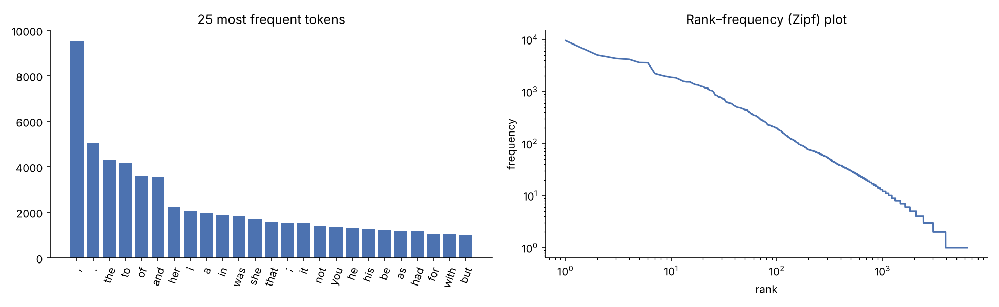
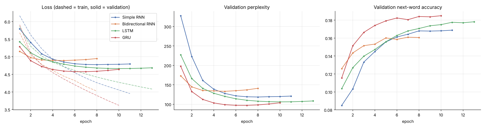
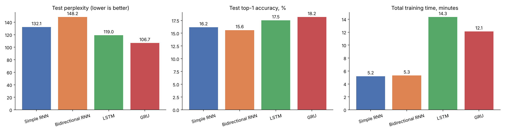
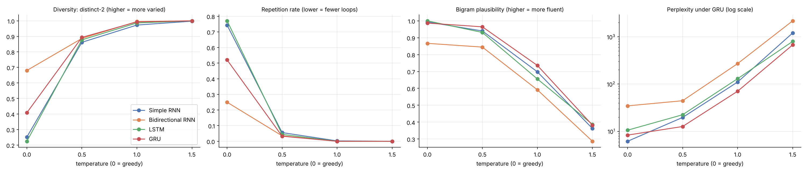

# Autoregressive Text Generation on *Pride and Prejudice* :Simple RNN vs Bidirectional RNN vs LSTM vs GRU

**Course:** Foundations of Generative AI (ICT4403) — Assignment 2
**Author:** _Riddhima Jain (230953108)_

## 1. Problem statement and objective
Build a **word-level autoregressive text-generation system**: given the previous words, predict the next word, then append it and repeat to generate text sequentially from a seed.

Objectives:
1. Prepare a literary dataset and build input–target sequences for next-word prediction.
2. Implement and train **Simple RNN, Bidirectional RNN, LSTM and GRU** models under identical experimental conditions.
3. Compare them quantitatively (loss, perplexity, top-1 / top-5 accuracy, training time) and qualitatively (coherence, diversity, contextual consistency, repetition).
4. Generate text from the same seeds at several **sampling temperatures**, analyse how temperature affects the output, and identify the most effective model.

## 2. Dataset
| | |
|---|---|
| **Name** | *Pride and Prejudice*, Jane Austen (1813) |
| **Source** | Project Gutenberg eBook #1342 — https://www.gutenberg.org/ebooks/1342 |
| **File used** | Plain-text UTF-8 edition, via Project Gutenberg's GitHub mirror: https://raw.githubusercontent.com/GITenberg/Pride-and-Prejudice_1342/master/1342-0.txt (copy included in `data/`) |
| **Licence** | Public domain |

**Characteristics** (after removing the Gutenberg header and licence):

| Statistic | Value |
|---|---|
| Characters | 684,810 |
| Chapters | 61 |
| Paragraphs | 2,124 |
| Sentences (approx.) | 5,775 |
| Words | 122,165 |
| Unique words (case-insensitive) | 6,380 |
| Mean sentence length | 21.2 words |
| Tokens after preprocessing (words + punctuation) | 139,158 |
| Vocabulary used (frequency ≥ 2, plus `<pad>`, `<unk>`) | 3,950 |
| Tokens mapped to `<unk>` | 1.73% |

The text is formal 19th-century prose with long, comma- and semicolon-heavy sentences, a large share of dialogue, a small recurring cast (Elizabeth 597 mentions, Darcy 374, Bennet 294, Jane 264, Bingley 257) and a Zipfian word distribution (2,404 words occur only once).



### Preprocessing
- Keep only the novel text (from *"It is a truth universally acknowledged"* to the Gutenberg end marker).
- Remove chapter headings, `_italics_` markers and quotation marks; normalise curly apostrophes; lower-case.
- `mr.` / `mrs.` lose the full stop so they do not look like sentence ends; dashes become comma-like pauses.
- Tokenise into words (keeping contractions/possessives such as `elizabeth's`) and the punctuation marks `. , ! ? ;`, which are kept as separate tokens so the models learn sentence structure.
- Words seen only once are mapped to `<unk>`, which is never sampled during generation.

### Input–target sequences
A sliding window of **20 tokens** is the input, and the following token is the target, e.g.

`it is a truth universally acknowledged , that a single man in possession of a good fortune , must be` → `in`

The token stream is split **by position** (first 80% train, next 10% validation, last 10% test) *before* windowing, so overlapping windows cannot leak between splits. This gives 111,306 training, 13,896 validation and 13,896 test sequences.

## 3. Models
All four models share one skeleton, so only the recurrent layer differs:

`Embedding(3950, 100) → recurrent layer (256 units) → Dropout(0.2) → Dense(3950, softmax)`

| Model | Recurrent layer | Parameters | Description |
|---|---|---|---|
| Simple RNN | `SimpleRNN(256)` | 1,501,542 | Plain tanh recurrence; cheapest, but prone to vanishing gradients over long contexts. |
| Bidirectional RNN | `Bidirectional(SimpleRNN(256))` | 2,604,134 | Reads the 20-word context forwards and backwards and concatenates both states. Both directions see only past words, so there is no target leakage, but the whole window must be re-read at every generation step. |
| LSTM | `LSTM(256)` | 1,775,718 | Input, forget and output gates plus a cell state for long-range memory. |
| GRU | `GRU(256)` | 1,685,094 | Update and reset gates; LSTM-like memory with fewer parameters. |

**Identical training conditions:** same data split and random seed (42), Adam (lr = 0.001, gradient clipping at norm 1.0), batch size 256, sparse categorical cross-entropy, at most 25 epochs, and early stopping on validation loss (patience 3, best weights restored).

## 4. Execution steps and dependencies
**Dependencies:** Python 3.10+, `tensorflow>=2.16`, `numpy`, `pandas`, `matplotlib`, `jupyter` (see `requirements.txt`).

**Google Colab (recommended):**
1. Open `Pride_and_Prejudice_Text_Generation.ipynb` in Colab and select *Runtime → Change runtime type → GPU*.
2. *Runtime → Run all*. The dataset is downloaded automatically if `data/pride_and_prejudice.txt` is missing.

**Local:**
```bash
git clone <this-repo-url>
cd <repo-folder>
pip install -r requirements.txt
jupyter notebook Pride_and_Prejudice_Text_Generation.ipynb   # then Run All
```
The notebook writes all metrics, plots and generated samples to `results/` and the trained models to `models/`.

## 5. Repository structure
```
├── Pride_and_Prejudice_Text_Generation.ipynb   # full implementation, executed with outputs
├── data/pride_and_prejudice.txt                # dataset (Project Gutenberg #1342)
├── results/
│   ├── model_metrics.csv          # test loss, perplexity, accuracy, timing per model
│   ├── generation_metrics.csv     # diversity / repetition / coherence per model × temperature
│   ├── summary.csv                # combined comparison table
│   ├── training_history.json      # per-epoch loss and accuracy
│   ├── dataset_stats.json
│   ├── generated_samples.md       # every generated text (all models, seeds, temperatures)
│   ├── generated_samples.json
│   └── plots/                     # training curves, test metrics, temperature effects, word frequency
├── requirements.txt
└── README.md
```

## 6. Results
The results below come from the executed notebook in this repository (CPU run, 2 cores). Absolute training times will be much shorter on a GPU, but the relative ordering of the quality metrics is what matters.

### 6.1 Quantitative evaluation (held-out test set)
| Model | Params | Test loss | **Test perplexity** | Top-1 acc. | Top-5 acc. | Best epoch / run | Sec / epoch | Train time | ms / generated word |
|---|---|---|---|---|---|---|---|---|---|
| Simple RNN | 1.50 M | 4.884 | 132.1 | 16.2% | 37.5% | 8 / 11 | 26.8 | 5.2 min | 33.5 |
| Bidirectional RNN | 2.60 M | 4.998 | 148.2 | 15.6% | 35.8% | 5 / 8 | 39.8 | 5.3 min | 62.1 |
| LSTM | 1.78 M | 4.779 | 119.0 | 17.5% | 39.1% | 10 / 13 | 64.2 | 14.3 min | 45.5 |
| **GRU** | 1.69 M | **4.670** | **106.7** | **18.2%** | **40.5%** | 7 / 10 | 72.6 | 12.1 min | 57.6 |




**Observations**
- **GRU is best on every quality metric**: lowest perplexity (106.7, about 20% lower than the Simple RNN) and the highest top-1 and top-5 accuracy. It also converges quickly, reaching its best validation loss at epoch 7, earlier than the LSTM (epoch 10).
- **LSTM is second** (perplexity 119.0). It learns more slowly but steadily and needs the most epochs (best at epoch 10).
- **Simple RNN** is the cheapest per epoch but plateaus at a higher loss. With a 20-word window and gradient clipping it remains competitive, which shows that the window is short enough to limit vanishing-gradient problems.
- **The Bidirectional RNN is worst on the test set** despite being best after epoch 1. With about 1.6× the parameters of the others, it overfits the ~111k training windows fastest (its validation loss rises from epoch 5). The backward pass adds little for next-word prediction because the most useful information, the last few words, is already at the end of the forward pass.
- **Training time:** on this CPU the gated models cost 2.5–3× more per epoch than the Simple RNN (GRU's kernel is the slowest on CPU). On a Colab GPU, LSTM and GRU use cuDNN kernels and the gap becomes much smaller.

### 6.2 Generation metrics (averaged over 3 seeds × 3 samples, 50 generated words each)
| Model | Temperature | Distinct-2 ↑ | Repetition ↓ | Bigram plausibility ↑ | Novel 4-grams | Perplexity under GRU ↓ |
|---|---|---|---|---|---|---|
| Simple RNN | greedy | 0.25 | 0.74 | 0.99 | 0.55 | 6.2 |
| | 0.5 | 0.86 | 0.06 | 0.94 | 0.72 | 19.7 |
| | 1.0 | 0.97 | 0.00 | 0.70 | 0.94 | 110.6 |
| | 1.5 | 1.00 | 0.00 | 0.36 | 1.00 | 1205.9 |
| Bidirectional RNN | greedy | 0.68 | 0.25 | 0.87 | 0.65 | 34.6 |
| | 0.5 | 0.89 | 0.03 | 0.84 | 0.74 | 44.4 |
| | 1.0 | 1.00 | 0.00 | 0.59 | 0.98 | 271.1 |
| | 1.5 | 1.00 | 0.00 | 0.29 | 1.00 | 2179.2 |
| LSTM | greedy | 0.22 | 0.77 | 1.00 | 0.65 | 10.6 |
| | 0.5 | 0.88 | 0.04 | 0.93 | 0.73 | 22.4 |
| | 1.0 | 0.99 | 0.00 | 0.66 | 0.96 | 130.2 |
| | 1.5 | 1.00 | 0.00 | 0.39 | 1.00 | 800.1 |
| **GRU** | greedy | 0.41 | 0.52 | 0.99 | 0.60 | 8.3 |
| | **0.5** | **0.89** | **0.03** | **0.96** | 0.70 | **12.6** |
| | 1.0 | 0.99 | 0.00 | 0.74 | 0.95 | 70.6 |
| | 1.5 | 1.00 | 0.00 | 0.38 | 0.99 | 674.9 |

Metric definitions: *Distinct-2* = unique bigrams ÷ bigrams (diversity); *Repetition* = share of trigrams that repeat an earlier trigram (loops); *Bigram plausibility* = share of generated bigrams that occur in the training text (local fluency); *Novel 4-grams* = share not copied from the training text (originality); *Perplexity under GRU* = how plausible the continuation of the seed looks to the best model (contextual consistency). The last column slightly favours the GRU's own samples, so it should be read alongside the other columns.

### 6.3 Qualitative comparison (examples from `results/generated_samples.md`, seed in bold)
At **T = 0.5**:
- **GRU:** **It is a truth universally acknowledged that** he could not have a finer difference in the world, and that he had not been to wish to be in love with his own, and the best of his friend, and the other of the officers…
- **LSTM:** **It is a truth universally acknowledged that** he is no very so politeness. You have not have many more other, and I have done in a man? But it is not, and I am afraid of her sister…
- **Simple RNN:** **Elizabeth could not help thinking that** he could not have to say to his friend. I should not not so much as you. He is not to see the other day which is not much decided…
- **Bidirectional RNN:** **Elizabeth could not help thinking that** the Phillips's Gardiner it the same, and at Lucas, were, and she had been concerned, with the girls…

| Criterion | Simple RNN | Bidirectional RNN | LSTM | GRU |
|---|---|---|---|---|
| Coherence (grammatical, readable clauses) | Fair; short clauses but frequent broken grammar | Weakest; strings of names and mismatched words | Good; Austen-like phrases | **Best**; longest grammatical stretches |
| Diversity | Lowest under greedy decoding | High, but partly because it is less fluent | Good | Good, higher than LSTM under greedy decoding |
| Contextual consistency with the seed | Drifts quickly to stock phrases (*"I am sure"*) | Often ignores the seed | Keeps the subject for a clause or two | **Keeps the seed's subject longest** (e.g. "he … his friend … the officers") |
| Repetition | Severe under greedy decoding (*"I am sure, I am sure…"*) | Least looping under greedy decoding, but incoherent | Severe under greedy decoding (*"and the other of the evening…"*) | Moderate under greedy decoding |

## 7. Sampling-temperature analysis


- **Greedy decoding (T → 0)** always picks the most frequent continuation, so every model falls into loops. The Simple RNN and LSTM repeat 74–77% of their trigrams (*"I am sure, I am sure, …"*). Each bigram is plausible, but the text has no content.
- **T = 0.5** is the best trade-off for all four models. Repetition drops to 3–6%, diversity (distinct-2) rises to about 0.86–0.89, and 93–96% of bigrams are still plausible for every model except the Bidirectional RNN (84%). Sentences are grammatical over 5–15 words and stay close to the seed's subject.
- **T = 1.0** samples from the learnt distribution as-is. Text becomes almost loop-free and highly novel (≈95% new 4-grams), but bigram plausibility falls to 0.59–0.74, so sentences become less grammatical and topics drift. The vocabulary is noticeably more Austen-specific (*"eligible young men"*, *"Miss De Bourgh"*).
- **T = 1.5** flattens the distribution so much that output turns into word salad (bigram plausibility 0.29–0.39, perplexity under the GRU of 675–2,179). Diversity is maximal, but coherence and contextual consistency are lost.

**Trend:** raising the temperature monotonically increases diversity and reduces repetition, at the cost of coherence and consistency. The best range for this dataset is **T ≈ 0.5–0.7**. The GRU degrades most gracefully: at T = 0.5 and T = 1.0 it has the highest bigram plausibility, and at every sampled temperature its continuations have the lowest perplexity.

## 8. Conclusion
**The GRU provides the most effective autoregressive generation for *Pride and Prejudice*.** It achieves the lowest test perplexity (106.7 vs 119.0 for the LSTM, 132.1 for the Simple RNN and 148.2 for the Bidirectional RNN) and the best top-1 and top-5 accuracy (18.2% and 40.5%), and it converges in fewer epochs than the LSTM. Its generated text is the most fluent and the most consistent with the seed at temperatures of 0.5–1.0. Its gating gives LSTM-like memory with fewer parameters, which suits a small (~140k-token) corpus where larger models overfit.

The **LSTM** is a close second. The **Simple RNN** is fast and surprisingly competitive with a 20-word window but loops badly. The **Bidirectional RNN** is the least suitable: it has the most parameters and overfits fastest, its backward pass adds little for predicting the *next* word, and it must re-read the whole context at every step, which makes generation the slowest.

**Recommended configuration:** GRU with temperature sampling at T ≈ 0.5.

Possible improvements: stacked recurrent layers, a longer context window, a larger corpus (e.g. all of Austen's novels), top-k / nucleus sampling, or a Transformer decoder for comparison.
